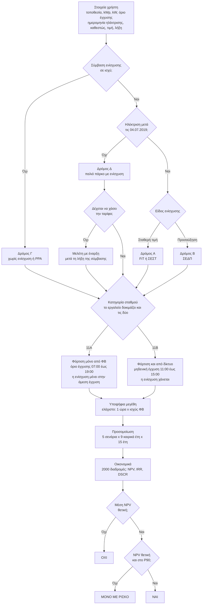
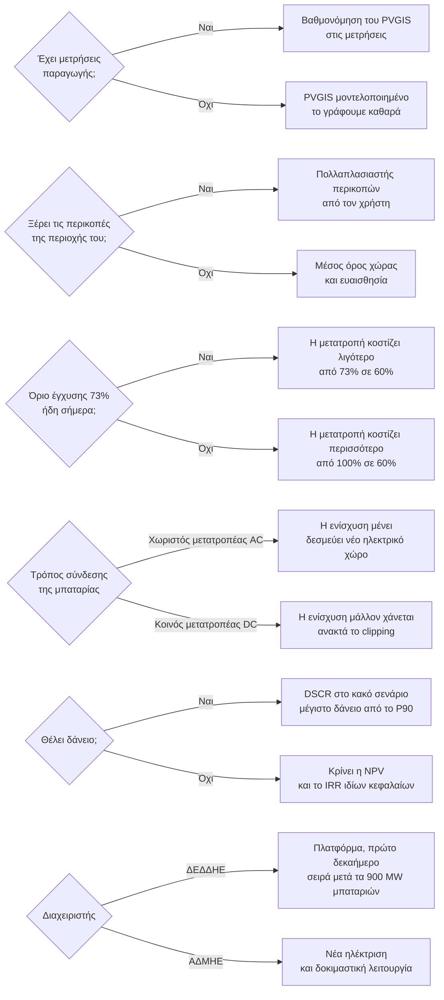
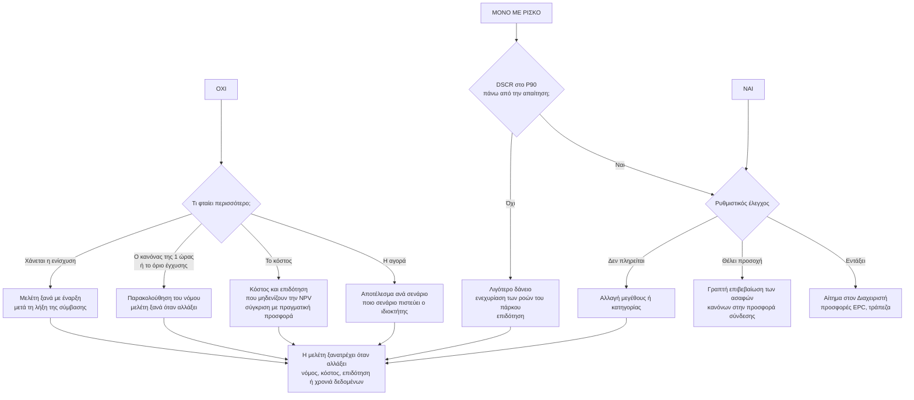

# Διάγραμμα ροής: πώς χειριζόμαστε κάθε περίπτωση πάρκου

Τα στοιχεία του χρήστη οδηγούν σε διαφορετικούς δρόμους. Κάθε δρόμος έχει άλλους κανόνες, άλλη πηγή αξίας και άλλη τυπική απάντηση. Το έγγραφο δείχνει τους δρόμους, τι αλλάζει σε καθέναν και τι δεν έχουμε λάβει υπόψη.

Οι παραπομπές REG-x είναι στο [ρυθμιστικό μητρώο](REGULATORY_REGISTER.md), οι D-x στο [Decision Log](DECISION_LOG.md), οι DIF-x στο [μητρώο δυσκολιών](DIFFICULTIES.md).

## 1. Η κύρια ροή

Τρεις ερωτήσεις χωρίζουν τα πάρκα σε τέσσερις δρόμους. Μετά η αλυσίδα υπολογισμού είναι κοινή.

## 2. Τι αλλάζει σε κάθε δρόμο

| | Δρόμος Α: FiT ή ΣΕΣΤ μετά το 2019 | Δρόμος Β: ΣΕΔΠ | Δρόμος Γ: χωρίς ενίσχυση ή PPA | Δρόμος Δ: παλιό πάρκο με ενίσχυση |
|:-|:-|:-|:-|:-|
| Επιτρέπεται το 11Α με διατήρηση ενίσχυσης | Ναι (REG-A-001) | Ναι (REG-A-001) | Δεν υπάρχει ενίσχυση | Ο νόμος δεν το καλύπτει (REG-A-002) |
| Τι παίρνει η άμεση έγχυση ΦΒ | Σταθερή τιμή | Τιμή αγοράς συν προσαύξηση | Τιμή αγοράς ή τιμή PPA | Σταθερή τιμή όσο δεν μπαίνει μπαταρία |
| Τι παίρνει η ενέργεια της μπαταρίας | Τιμή αγοράς (REG-A-006) | Τιμή αγοράς | Τιμή αγοράς (ή PPA, αν το λέει η σύμβαση) | Τιμή αγοράς |
| Τι κοστίζει η φόρτιση | Την ταρίφα που χάνεται | Τιμή αγοράς συν προσαύξηση που χάνεται | Την τιμή αγοράς της ώρας | Όλη την ταρίφα, αν χαθεί η σύμβαση |
| Από πού έρχεται η αξία | Μόνο ενέργεια που αλλιώς χάνεται: όριο έγχυσης, περικοπές | Επεισόδια αρνητικών τιμών, περικοπές, όριο έγχυσης | Διαφορά μεσημέρι προς βράδυ, μηδενικές τιμές, περικοπές | Καμία όσο ισχύει η σύμβαση |
| Το 11Β έχει νόημα; | Σχεδόν ποτέ: χάνεται η ταρίφα | Σχεδόν ποτέ: χάνεται η προσαύξηση | Σπάνια: χάνεται η μεσημεριανή έγχυση | Όχι |
| Το στοιχείο που κρίνει το αποτέλεσμα | Περικοπές της περιοχής | Τιμή αναφοράς, κανόνας αρνητικών τιμών | Σενάριο αγοράς, κόστος | Έτος λήξης της σύμβασης |
| Ασαφής κανόνας που μετράει | Ποιος εκκαθαρίζει την ενέργεια της μπαταρίας | Πώς υπολογίζεται η προσαύξηση με μπαταρία (REG-B-050) | Όριο 60% ή 40% (REG-A-009) | Αν μπορεί να κρατήσει την ταρίφα |
| Αποτέλεσμα στο παράδειγμά μας | Δεν τρέξαμε παράδειγμα | Όχι: NPV μείον 154 χιλ. σε επένδυση 269 χιλ. | Όχι: μείον 515 χιλ. σε 1.045 χιλ. Με επιδότηση 60%: μόνο με ρίσκο | Όχι: χάνει 111 χιλ. τον χρόνο από την ταρίφα |

Κοινά σε όλους τους δρόμους: ελάχιστη ωφέλιμη χωρητικότητα 1 ώρα επί την ισχύ του ΦΒ (REG-A-007), κοινό όριο έγχυσης για ΦΒ και μπαταρία, εντολές περικοπής που ισχύουν και για τη μπαταρία, καμία αποζημίωση περικοπών.

## 3. Τι αλλάζει ανάλογα με τα υπόλοιπα στοιχεία του χρήστη

## 4. Τι κάνουμε μετά την απάντηση

## 5. Τι δεν έχουμε λάβει υπόψη

Η τελευταία στήλη λέει προς τα πού σπρώχνει το αποτέλεσμα η παράλειψη: «αισιόδοξο» σημαίνει ότι η μπαταρία φαίνεται καλύτερη από ό,τι είναι.

### Περιπτώσεις πάρκων που δεν χωράνε στους τέσσερις δρόμους

| Τι λείπει | Γιατί μετράει | Επίδραση |
|:-|:-|:-|
| Μπαταρία τρίτου ή χωριστός σταθμός αποθήκευσης στο κοινό σημείο σύνδεσης (άρθρο 11Γ παρ. 5) | Είναι ο μόνος πιθανός δρόμος για παλιά πάρκα FiT χωρίς απώλεια ταρίφας | Άγνωστη |
| Ενοικίαση μπαταρίας, σύμβαση με optimiser με εγγυημένο ελάχιστο έσοδο | Αλλάζει ποιος φέρει το ρίσκο της αγοράς | Άγνωστη |
| Επέκταση FiT: 7 έτη με 90 ευρώ/MWh έως 1.500 kWh/kWp (REG-B-002) | Το μοντέλο έχει μία τιμή και ένα έτος λήξης. Η ενέργεια πάνω από το όριο δεν πληρώνεται, άρα μπαταρία θα είχε αξία εκεί | Απαισιόδοξο για αυτά τα πάρκα |
| ΣΕΣΤ άνω των 400 kW: κόστος εξισορρόπησης που παρακρατεί η ΔΑΠΕΕΠ (REG-B-030) | Μειώνει το σημερινό έσοδο του πάρκου | Μικρή |
| Πάρκα με αυτοκατανάλωση, ενεργειακές κοινότητες, μη διασυνδεδεμένα νησιά, χαμηλή τάση, αιολικά | Άλλοι κανόνες. Το εργαλείο δεν τα αναγνωρίζει | Εκτός εμβέλειας |
| Λεπτομέρειες PPA: προφίλ, ελάχιστος όγκος, ποιος φέρει τις περικοπές, εγγυήσεις προέλευσης | Το μοντέλο έχει μόνο μία σταθερή τιμή | Άγνωστη |
| Μετάβαση από 11Α σε 11Β αργότερα (επιτρέπεται, REG-A-030) | Έχει αξία ως επιλογή όταν λήξει η ενίσχυση | Απαισιόδοξο |

### Κανόνες και διαδικασία

| Τι λείπει | Γιατί μετράει | Επίδραση |
|:-|:-|:-|
| Οι κανόνες μένουν σταθεροί για 15 έτη | Το άρθρο 11Γ άλλαξε δύο φορές μέσα στο 2026. Ο ρυθμιστικός κίνδυνος δεν είναι σενάριο | Άγνωστη, μεγάλη |
| Χρόνος αδειοδότησης και σύνδεσης | Δεν υπάρχει προθεσμία απάντησης. Η μελέτη υποθέτει λειτουργία από το 2027 | Αισιόδοξο |
| Διακοπή του πάρκου στα έργα και στη νέα δοκιμαστική λειτουργία | Χαμένο έσοδο ΦΒ για άγνωστο διάστημα | Αισιόδοξο |
| Κόστος έργων σύνδεσης: 50% σήμερα, ίσως 100% (REG-A-038) | Είναι μέσα σε ένα σταθερό ποσό που εκτιμήσαμε | Αισιόδοξο |
| Επιδότηση κεφαλαίου που μειώνει τη λειτουργική ενίσχυση (REG-B-039) | Δεν την αφαιρούμε | Αισιόδοξο με επιδότηση |
| Απώλεια προτεραιότητας κατανομής σε «σημαντική τροποποίηση» (REG-B-027) | Αφορά μικρά και παλιά πάρκα | Άγνωστη |
| Αν η 1 ώρα πρέπει να ισχύει και μετά τη φθορά | Θα ήθελε μεγαλύτερη μπαταρία ή ενίσχυση χωρητικότητας | Αισιόδοξο |
| Ευέλικτες συμβάσεις σύνδεσης (εκκρεμούν) | Μπορεί να αλλάξουν τα όρια έγχυσης | Άγνωστη |

### Αγορά και έσοδα

| Τι λείπει | Γιατί μετράει | Επίδραση |
|:-|:-|:-|
| Αγορά εξισορρόπησης και ενδοημερήσια αγορά | Για αυτόνομες μπαταρίες είναι σημαντικό μέρος του εσόδου | Απαισιόδοξο |
| Κόστος αποκλίσεων και μείωσή του από τη μπαταρία | Τα δεδομένα υπάρχουν στο repository, δεν χρησιμοποιούνται | Απαισιόδοξο |
| Μελλοντικοί μηχανισμοί στήριξης ευελιξίας ή ισχύος (REG-B-044) | Πιθανό νέο έσοδο | Απαισιόδοξο |
| Γειτονικές αγορές | Μπαίνουν μόνο ως μία μετατόπιση ανά σενάριο | Άγνωστη |
| Τοπική συμφόρηση και περικοπές ανά υποσταθμό | Ο κανόνας επιμερισμού δεν βρέθηκε. Ο χρήστης δίνει έναν πολλαπλασιαστή | Άγνωστη |
| Περικοπές σε ώρες θετικής τιμής | Το μοντέλο περικόπτει μόνο σε ώρες μηδενικής τιμής | Απαισιόδοξο για τον δρόμο Α |
| Λειτουργία με πραγματική πρόβλεψη | Ένας συντελεστής 0,90. Σε πάρκο ΣΕΔΠ οι απλές πολιτικές πιάνουν 46 έως 50% (DIF-022) | Αισιόδοξο για τον δρόμο Β |
| Έκτακτες παρεμβάσεις: πλαφόν εσόδων, εισφορές όπως το 2022 έως 2023 | Χτυπούν ακριβώς τις χρονιές υψηλών τιμών | Αισιόδοξο |
| Σφάλμα του μοντέλου τιμών πέρα από το ±25% που μετρήσαμε | Δεν έχει δοκιμαστεί σε αγορά με πολλές μπαταρίες | Άγνωστη |

### Μπαταρία και εγκατάσταση

| Τι λείπει | Γιατί μετράει | Επίδραση |
|:-|:-|:-|
| Διαθεσιμότητα: βλάβες και συντήρηση μπαταρίας και πάρκου | Το μοντέλο υποθέτει 100% | Αισιόδοξο |
| Πτώση της απόδοσης με τα χρόνια | Η απόδοση μένει 88% | Αισιόδοξο |
| Θερμοκρασία | Σταθερή στους 25 °C. Το ελληνικό καλοκαίρι ανεβάζει και τη φθορά και τα βοηθητικά | Αισιόδοξο |
| Πραγματικοί όροι εγγύησης και κατανάλωση βοηθητικών | Δεν βρέθηκαν δημόσια | Άγνωστη |
| Αξία στο τέλος των 15 ετών | Μηδέν, ενώ η μπαταρία τελειώνει στο 84 έως 93% | Απαισιόδοξο |
| Μεταβλητότητα παραγωγής μέσα στην ώρα | Ομαλή παρεμβολή, χωρίς σύννεφα | Άγνωστη |
| Συμβατότητα υφιστάμενων μετατροπέων με DC σύζευξη, χώρος, πυρασφάλεια | Μπορεί να αποκλείσουν μια λύση πριν από κάθε υπολογισμό | Εκτός εμβέλειας |

### Οικονομικά και απόφαση

| Τι λείπει | Γιατί μετράει | Επίδραση |
|:-|:-|:-|
| DSCR όλου του πάρκου και το υφιστάμενο δάνειο | Υπολογίζουμε μόνο τις ροές της μπαταρίας. Η τράπεζα κοιτά το σύνολο | Απαισιόδοξο για τη χρηματοδότηση |
| Εναλλακτικές χρήσεις του ίδιου κεφαλαίου: περισσότερα ΦΒ, αναβάθμιση, κατάθεση, πώληση του πάρκου | Το έθεσε το brainstorming. Υπάρχει μόνο μέσα από το επιτόκιο προεξόφλησης | Δεν απαντιέται |
| Πότε να γίνει η επένδυση | Το κόστος πέφτει περίπου 3% τον χρόνο, η διαφορά τιμών συμπιέζεται. Το εργαλείο τρέχει με όποιο έτος του δοθεί, δεν βρίσκει το καλύτερο | Δεν απαντιέται |
| Μορφή ιδιοκτήτη: φυσικό πρόσωπο ή εταιρεία, ΦΠΑ, κεφάλαιο κίνησης, τόκοι κατασκευής | Φόρος 22% εταιρείας για όλους | Μικρή |
| Χαρτοφυλάκιο: ιδιοκτήτης με πολλά πάρκα, όροι του ΦοΣΕ | Κάθε πάρκο μελετιέται μόνο του | Άγνωστη |
| Υποκειμενικά βάρη σεναρίων | Το σενάριο εξηγεί το 21 έως 47% της διασποράς | Άγνωστη |

### Αξιοπιστία της ίδιας της μελέτης

- Κανένα αποτέλεσμα δεν συγκρίθηκε με πραγματικό πάρκο που έχει μπαταρία.
- Καμία συζήτηση με εγκαταστάτη, τράπεζα, ΦοΣΕ ή δικηγόρο. 16 από τις 34 υποθέσεις είναι εκτιμήσεις χωρίς πηγή.
- Ο δρόμος Α (FiT ή ΣΕΣΤ μετά το 2019) δεν έχει δοκιμαστεί με παράδειγμα.
- Η άδεια των δεδομένων τιμών δεν επιτρέπει δημόσια αναδημοσίευση (D-024).

## 6. Τι βγαίνει από όλα αυτά

1. Ο πρώτος διαχωρισμός δεν είναι μόνο το καθεστώς. Είναι το καθεστώς μαζί με την ημερομηνία ηλέκτρισης, γιατί αυτή κρίνει αν η ενίσχυση επιβιώνει.
2. Για πάρκα με ενίσχυση η μπαταρία δεν είναι εργαλείο arbitrage. Είναι εργαλείο διάσωσης ενέργειας που αλλιώς χάνεται. Η αξία της εξαρτάται από περικοπές και όρια, που είναι ακριβώς τα στοιχεία που ξέρουμε λιγότερο.
3. Οι παραλείψεις δεν δείχνουν όλες προς την ίδια κατεύθυνση. Τα έσοδα που δεν μετράμε (εξισορρόπηση, υπολειμματική αξία) κάνουν το αποτέλεσμα απαισιόδοξο. Οι τεχνικές και διαδικαστικές απλουστεύσεις (διαθεσιμότητα, καθυστερήσεις, πρόβλεψη) το κάνουν αισιόδοξο. Δεν ξέρουμε ποιο υπερισχύει.
4. Τρεις παραλείψεις αξίζει να κλείσουν πρώτες, γιατί μπορούν να γυρίσουν απάντηση: τα έσοδα εξισορρόπησης, ο DSCR όλου του πάρκου, και η μπαταρία τρίτου στο κοινό σημείο σύνδεσης για τα παλιά πάρκα FiT.
